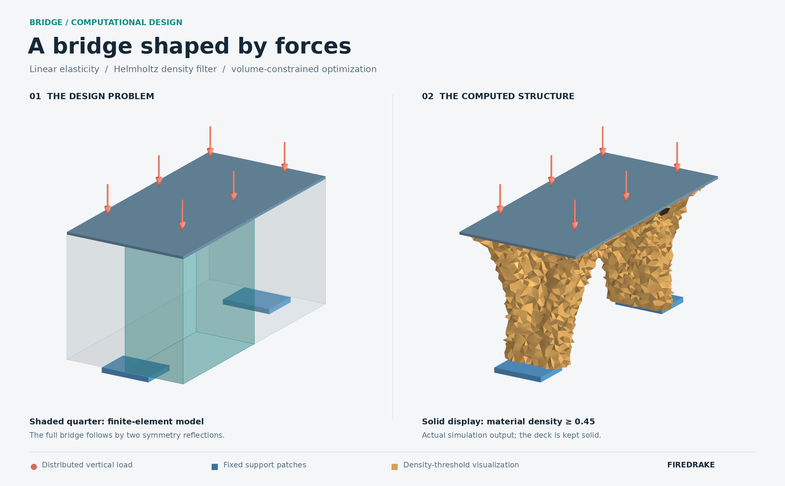

# Bridge topology optimization

[Original example and article](https://www.migueloptimization.com/posts/open-source/)
by Miguel Salazar de Troya, updated for Firedrake 2026.10.0.

## Changes

- Updated Firedrake/adjoint and VTK APIs; removed one unused zero-length Gmsh line.
- Default mesh size is **0.03**, coarsened from **0.015** for local memory limits.
  The original geometry file is retained. Two MPI processes are used by default.
- Added Docker run scripts and exports for figures, history, and an HTML report.

## Install and run

Install Docker and start its engine (on macOS: `open -a Docker`). From this clone:

```bash
./scripts/build.sh
./scripts/run.sh
./scripts/verify.sh
./scripts/open.sh
```

The Dockerfile uses the official `firedrake-vanilla-default:2026.10.0` image
and installs Gmsh, [pyMMAopt](https://github.com/LLNL/pyMMAopt/tree/934c0f304354fcb9430e2c326dedf557e3705eab),
and plotting dependencies.

To use the original mesh resolution (requires more memory):

```bash
BRIDGE_MESH_SCALE=1 ./scripts/run.sh output/original
```

`BRIDGE_MPI_RANKS=1` selects one process. Default output is `output/demo/` on your
computer: open `report.html`, `bridge.png`, or `convergence.png` directly, or use
ParaView for `final.pvd` and its companion folder. No copying out of Docker is needed.
Regenerate figures with `./scripts/render.sh`.

The local mesh completed 201 MMA updates and passed the
[saved checks](docs/verification.json); it reached the original iteration limit.
Mesh reduction and display smoothing can change its appearance from the article.



## Licenses

The original bridge is [MIT licensed](LICENSE). pyMMAopt uses
[GPL-2.0](https://github.com/LLNL/pyMMAopt/blob/934c0f304354fcb9430e2c326dedf557e3705eab/LICENSE),
and Firedrake uses LGPL-3.0-or-later. pyMMAopt's original source and notices
are retained under `/opt/pyMMAopt` in the Docker image.
