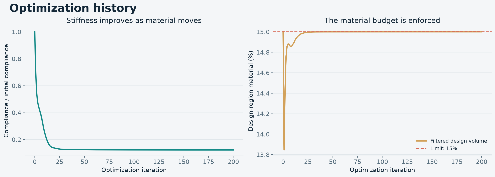

# Bridge topology optimization with current Firedrake

Run Miguel Salazar de Troya's three-dimensional bridge example with Firedrake
2026.10.0 in Docker. Installation, meshing, optimization, and rendering all run in
the container. Results are saved directly in your checkout so you can open the
figures, report, and ParaView files on your computer.

The original [blog post](https://www.migueloptimization.com/posts/open-source/)
explains the bridge problem. This fork updates the implementation and adds a
reproducible environment, numerical checks, and a graphical report.


## Start Docker

Install [Docker Desktop](https://docs.docker.com/get-started/get-docker/) on macOS
or [Docker Engine](https://docs.docker.com/engine/install/) on Linux. No host
Python, Firedrake, Gmsh, or graphics installation is required to run the example.

On macOS, open Docker Desktop and wait for its engine to be running. You can also
start it from Terminal:

```bash
open -a Docker
docker info
```

On a Linux system that uses systemd, start the installed engine with
`sudo systemctl start docker`. Your user must have permission to run `docker info`;
follow Docker's installation instructions for your system.

Use the native architecture of your computer. The scripts support Apple Silicon
and x86-64 without forcing CPU emulation. Allocate at least 8 GB of memory to
Docker Desktop for the default example. Finer three-dimensional meshes require
more memory and time.

## Build and run

Open a terminal in your clone of this fork:

```bash
./scripts/build.sh
./scripts/verify.sh
./scripts/run.sh
./scripts/open.sh
```

The build downloads a pinned official Firedrake image and installs the additional
packages in [Dockerfile](Dockerfile) and [requirements.txt](requirements.txt).
`verify.sh` runs a small, complete optimization with finite-difference sensitivity
checks, preceded by geometry, filter, and linear solver consistency checks.
`run.sh` runs the default bridge optimization and produces the report in
`output/demo/`. The defaults are mesh size `0.04`, 200 MMA steps, and a 15%
design-region volume limit. `open.sh` opens that report in your host web browser.

The initial image download is large. The first solve also compiles finite element
kernels. Leave the terminal running until the optimizer and renderer finish.
You can interrupt a run with Ctrl-C. Completed outputs stay in your checkout.

All solver options are available through:

```bash
./scripts/run.sh --help
```

For example, choose a different mesh and output directory:

```bash
./scripts/run.sh --mesh-size 0.08 --max-iterations 120 --output-dir output/my-bridge
./scripts/open.sh output/my-bridge
```

Smaller `--mesh-size` values produce finer meshes. A run with only a few iterations
checks that the software works; the resulting material distribution is not a
converged bridge design. Use a separate output directory when comparing runs.

## Open results outside Docker

The scripts mount the repository at `/workspace` inside the container. Therefore
`/workspace/output/demo` is exactly `output/demo` in your host checkout. No
`docker cp` command is needed, and deleting a container does not delete results.
The container runs as your host user so its output files can be edited normally
on Linux as well as macOS.

- Open `output/demo/report.html` in a browser using `./scripts/open.sh` or your
  file manager. The report includes the bridge illustration and optimization
  history.
- Open `output/demo/bridge.png` and `output/demo/convergence.png` in Preview on
  macOS or your usual image viewer.
- Open `output/demo/final.pvd` or `output/demo/bridge_evolution.pvd` in a host installation of
  [ParaView](https://www.paraview.org/download/) for the original finite element
  fields. Keep its accompanying data directory alongside it.
- `output/verification/` contains the small verification run. Open it with
  `./scripts/open.sh output/verification`.

No desktop display server is forwarded into the container. Static figures and
the report are generated using offscreen rendering.

To regenerate the figures from saved results, without rerunning optimization:

```bash
./scripts/render.sh output/demo
./scripts/open.sh output/demo
```

The HTML report is self-contained and works offline. Its three-dimensional
bridge view can be rotated and zoomed in your browser. The full bridge is
reconstructed by reflecting the computed quarter across its two symmetry
planes; the image also identifies the quarter used in the finite element solve.

## Model and numerical checks

This is a deterministic, three-dimensional compliance-minimization problem with
linear elasticity, a Helmholtz density filter, RAMP material interpolation, a
fixed solid bridge deck, and a material volume limit. The finite element solve
uses one quarter of the bridge with symmetry boundary conditions.

The default volume fraction is 0.15 in the design domain. You can change it with
`--volume-fraction`. The filter length is controlled by `--filter-radius`.
These parameters change the optimization problem; retain the defaults when
reproducing the supplied example.

The filter retains the original discontinuous, piecewise-constant density and
interior-face jump discretization. Its default radius is `sqrt(0.0002)`, so the
squared coefficient in the Helmholtz operator matches the original script.

Two geometry fixes remove a zero-length line and apply the symmetry conditions
to the deck as well as the design domain. The optimizer starts at the feasible
volume fraction instead of the original 0.5 density. Compliance is normalized
by its initial value during optimization; the original constant factor of 10
has no effect on the minimizing design and is omitted.

The obsolete `pyMMAopt` interface is replaced with an adapter to
[mmapy](https://pypi.org/project/mmapy/). Objective and constraint derivatives are
assembled explicitly from the self-adjoint elasticity and filter equations.
The `--verify-gradient` option checks both against directional finite
differences. This implementation does not require an old Firedrake adjoint
package.

To check the initial state and derivatives without an optimization run:

```bash
./scripts/run.sh --mesh-size 0.15 --verify-gradient --check-only --no-render --output-dir output/gradient-check
```

Use `--no-render` to omit rendering, and `--solver direct` to select a direct
solver instead of the default FGMRES/GAMG iterative solver. The verification
helper exits with a nonzero status when the solver, numerical checks, or
rendering fails.

## Verified reference run

The Docker build, verification helper, and complete default optimization were
run on Apple Silicon using Firedrake 2026.10.0. The reference run used 39,656
tetrahedra and 24,099 displacement degrees of freedom. Compliance fell from
81.1610 to 9.9986 (87.68%) with a final design-region material fraction of
0.1499998. The 200-step iteration limit was reached before the density-change
tolerance; these results do not claim optimizer convergence.

[Reference metadata](docs/reference-summary.json) and
[independent numerical checks](docs/numerical-checks.json) record the measured
values. The checks cover CAD marker measures, constant-density and mass
preservation by the filter, direct/iterative solver agreement, and reduced
objective/volume derivatives at a nonuniform density. The default run also
passed its directional gradient check with second-order Taylor remainders.
The solve and gradient check took about 133 seconds on the test machine;
image download, environment build, and rendering take additional time.



## Environment controls

The normal commands use one BLAS/OpenMP thread to avoid oversubscription. You can
limit the container's CPU or memory allocation, or override the local image name:

```bash
BRIDGE_CPUS=4 BRIDGE_MEMORY=8g ./scripts/run.sh
BRIDGE_THREADS=2 ./scripts/run.sh --mesh-size 0.08 --output-dir output/two-threads
```

`BRIDGE_IMAGE` changes the local image tag for both `build.sh` and `run.sh`.
`BRIDGE_PLATFORM` can explicitly request `linux/arm64` or `linux/amd64`; normally
leave it unset to use your native CPU architecture. Rebuild after changing the
requested platform.

For an arbitrary command in the same mounted environment:

```bash
./scripts/container.sh python3 -c 'import importlib.metadata; print(importlib.metadata.version("firedrake"))'
./scripts/container.sh bash
```

The image pins the Firedrake release and additional Python package versions.
Runtime output and generated meshes are excluded from Git. A new Docker image
is only necessary when the environment changes; Python source changes are used
immediately through the bind mount.

## Troubleshooting

**Cannot connect to Docker:** start Docker Desktop or your Docker Engine service,
then verify `docker info` works in the same terminal.

**Container is killed, often with exit code 137:** increase Docker Desktop's
memory allocation or try a larger `--mesh-size` such as `0.10` or `0.15`.

**No report yet:** wait for the renderer to finish and check that you used the
same output directory with `run.sh` and `open.sh`. If you requested `--no-render`
there is no graphical report until you run `./scripts/render.sh` for that output
directory.

**Opening results on a headless Linux host:** copy the output directory to a
computer with a browser or image viewer. The report and figures are ordinary
files.

## Attribution

The original bridge example is by Miguel Salazar de Troya. See the original
[repository](https://github.com/salazardetroya/bridge_post) and [LICENSE](LICENSE).
The Docker environment installs third-party packages under their respective
licenses; in particular, `mmapy` is GPL-3.0 licensed.
